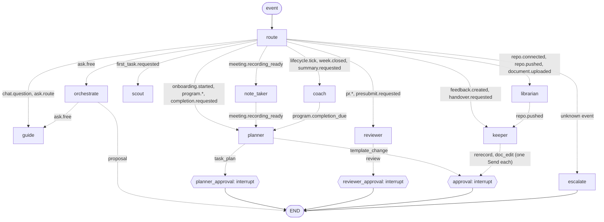

# app/agents: the multi-agent system

Welcome Wave's agents follow LangGraph's **supervisor pattern**: one Supervisor graph receives every event and routes it to
exactly one of eight specialists. Specialists never call each other. When one agent's work leads to another's (a push
re-indexed, then KT explanations checked), the next hop is an edge of the graph. That way every hop is retried, recorded,
checkpointed and traced the same way, and a run can pause for days while a person decides.

[docs/LANGGRAPH.md](../../../docs/LANGGRAPH.md) walks through the LangGraph code with line numbers.
[docs/AGENTS.md](../../../docs/AGENTS.md) is the full agent contract.

## Layout

```
app/agents/
├── supervisor/              the orchestrator: one LangGraph StateGraph that every event runs through
│   ├── graph.py             build_supervisor(): nodes, conditional edges, interrupts; run_event() and resume()
│   ├── state.py             State: what one run carries from node to node (plain values only)
│   ├── orchestrator.py      ask.free: which specialist takes a free-form request (a model decides; rules without one)
│   └── tick.py              lifecycle.tick: the daily event, once per organisation and day
├── specialists/             the eight workers, one package each, named by roster key
│   ├── librarian/agent.py   indexes repositories and documents, and keeps the index current
│   ├── note_taker/agent.py  turns a recorded KT session into notes linked to code
│   ├── guide/agent.py       answers with sources (the tiers subgraph)
│   │   └── qa.py            the chat's answer path: the one-call fallback
│   ├── planner/agent.py     the 30/60/90 plan, the completion review, template changes
│   │   └── task.py          the one-call plan, and matching a pull request to its task
│   ├── scout/agent.py       a safe first task and its brief
│   ├── reviewer/agent.py    pull request reviews, and the hire's private pre-submit review
│   │   └── review.py        the one-call review and the checks every review runs
│   ├── coach/agent.py       blockers, nudges and the weekly summary
│   └── keeper/agent.py      re-recordings, doc fixes and handovers
├── core/                    what every agent shares; it imports no agent
│   ├── deps.py              Deps: everything an agent may touch (the allowlist)
│   ├── llm.py               the model port (GeminiLLM, OfflineLLM, FakeLLM, NoLLM) and embed_data
│   ├── prompts.py           every system prompt, each with UNTRUSTED
│   ├── schemas.py           what a model must return (drafts) and the shapes agents hand on
│   ├── runtime.py           the agent loop run_agent (a think ⇄ act subgraph), the tool registry, budgets, traces
│   ├── thinking.py          think(): one specialist's loop with its mode, budget and run record
│   ├── registry.py          the roster (AGENTS), modes, explain, the checked writer, run records
│   └── citations.py         label_for: how a source is named wherever it is cited
└── tools/                   the read-only tools agents call inside their loop
    ├── knowledge.py         search_knowledge, read_file, find_symbol, verified_answers
    ├── people.py            kt_moments, code_owners, who_knows, kt_coverage
    ├── repo.py              issues, recent_changes, tests_for
    └── hire.py              hire_signals, program, first_task_candidates, cohort_evidence, pr_diff, kt_changes,
                             feedback_target, person_footprint
```

The Guide's research crew, which plans searches, retrieves, fuses and ranks evidence, lives in `app/rag/`
([docs/specs/rag-crew.md](../../../docs/specs/rag-crew.md)). It is a small LangGraph graph of its own that runs inside
the Guide's node and inside the `search_knowledge` tool: a pipeline of steps, not a separate agent.

## The graph

The diagram below is the compiled Supervisor graph, with the event labels grouped. `GET /api/agents` draws the same
edges from the compiled graph itself (`core/registry.graph_edges`). Dashed edges are conditional and carry their path-map label. Every specialist also
has `error → escalate` and `done → END`, left out here to keep the picture readable.



Inside a node, three specialists run a small subgraph of their own: the Guide (`start → tier1 → tier2 → person →
explain`), the Coach (`check → weekly`) and the Reviewer (`match → review`). Each thinking specialist's model work is
`core/runtime.run_agent`, a two-node loop:

```
think (one model turn, tools bound) ──tool calls──> act (run the read-only tools) ──> think ... ──final_answer──> END
```

## How a request flows

1. `Container.handle(event)` (`app/container.py`) claims the event, so it runs only once. Events a person waits for
   (`SYNC_EVENTS`) run on `chat_graph`, which has no checkpointer. Everything else runs on `graph`, checkpointed under the
   event's dedupe key.
2. `route` picks the specialist from `ROUTES`. The node is wrapped by `guarded`, which retries it, records the run and
   turns a failure into an `escalate` to the managers.
3. The specialist runs its rules, or `think()`: an agent loop over the read-only tools whose answer is a schema. Code then
   checks that answer (real ids and paths, caps, privacy, citations) before anything is kept.
4. A proposal (a plan, a review, a re-recording) parks the run at an `interrupt()`. The decision in Approvals reaches
   `Container.decide`, which resumes the run with `Command(resume=...)` from its last checkpoint.

The rest of the app reaches the agents through `Container.handle` and `Container.decide`. A few lifecycle services also
use a specialist's helpers directly: rules-only views (the Coach's blocker explain, the Planner's completion view, the
Scout's shortlist), the Guide's `qa` for answer routing, and the Reviewer's checks for the pre-submit review. The views ask
no model and record no run.

## Why these names

- **`supervisor/` and `specialists/`.** These are the two sides of the supervisor pattern: the router, and the workers it
  routes to. Any module's folder says which side it is on.
- **Specialists are named by roster key** (`core/registry.AGENTS`). The same key is the graph node, the run record's
  agent, `PATCH /api/agents/{key}` and the folder. Run records written before the roster existed keep their old names
  (ingestion, meeting, qa, task, review), and `core/registry.RUN_NAMES` maps them to the roster.
- **Every specialist's entry point is `agent.py`**, the module its Supervisor node calls. A helper that belongs to one
  agent sits next to it: `qa.py`, `task.py` and `review.py` are the one-call paths those agents fall back to.
- **Prompts and schemas stay in `core/`, one file each.** That gives one place to check that every system prompt carries
  `UNTRUSTED` (`tests/test_injection.py`) and that every model output is a validated schema. The offline model also
  dispatches on schema names, and the schemas are shared with the API, the stores and the research crew. Splitting them
  per agent would give import cycles (`core/llm.py` reads the schemas) and no new safety.
- **`state.py` is separate from `graph.py`.** The state is what the checkpointer stores while a run waits for a person.
  Keeping it small and on its own makes the "plain values only" rule easy to review.

## The dependency rule

```
supervisor ──> specialists ──> core
     │              │            ▲
     └──────────────┴──> tools ──┘
```

- `core` imports no specialist, no Supervisor module and no tool.
- `tools` import `core` only.
- A specialist imports `core` and `tools`, never another specialist and never the Supervisor.
- The Supervisor imports the specialists. Inside `app/agents`, it is the only package that does.

`tests/test_agents_layout.py` enforces this, including imports inside functions. It also checks that every roster agent
has its package and that this README names every module.

## Adding an agent

Follow [docs/AGENTS.md, "Adding an agent"](../../../docs/AGENTS.md#adding-an-agent). In short:

1. Create `specialists/<key>/` with an `__init__.py` (a one-line docstring) and `agent.py`.
2. Add the agent to `core/registry.AGENTS`.
3. Wire it into `supervisor/graph.py`: its events in `ROUTES`, its node and its labelled edges.
4. Add tests, and add the new modules to the layout above.

## Where the files moved (November 2026)

Before this layout, `app/agents/` was one flat folder. Older notes may still use the old names:

| Before | Now |
|---|---|
| `supervisor.py` | `supervisor/graph.py` (its `State` in `supervisor/state.py`) |
| `orchestrator.py`, `tick.py` | `supervisor/orchestrator.py`, `supervisor/tick.py` |
| `ingestion.py`, `meeting.py` | `specialists/librarian/agent.py`, `specialists/note_taker/agent.py` |
| `guide.py`, `qa.py` | `specialists/guide/agent.py`, `specialists/guide/qa.py` |
| `planner.py`, `task.py` | `specialists/planner/agent.py`, `specialists/planner/task.py` |
| `reviewer.py`, `review.py` | `specialists/reviewer/agent.py`, `specialists/reviewer/review.py` |
| `scout.py`, `coach.py`, `keeper.py` | `specialists/<key>/agent.py` |
| `deps.py`, `llm.py`, `prompts.py`, `schemas.py`, `registry.py`, `runtime.py`, `thinking.py` | `core/<same name>` |
| `qa.label_for` | `core/citations.label_for` |
| `qa.CATCH_ALL` | `app/services/codeowners.CATCH_ALL` |
| `coach.programs` | `core/registry.programs` |
| `ingestion.extract_pages` and its limits | `app/services/documents.py` |
| `ingestion.TooLarge` | `app/ports.TooLarge` |
