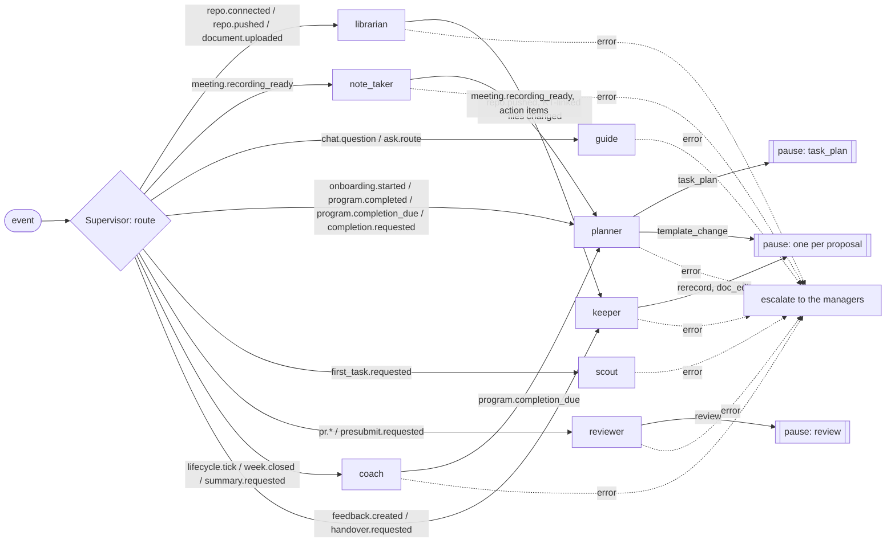

# The multi-agent model

Welcome Wave runs as one Supervisor and eight specialists in one LangGraph graph. The Supervisor routes every event to exactly
one specialist and pauses the run when a person has to decide. Specialists never call each other: a chain (a push, then the
KT check) goes through the Supervisor's graph. Agents propose; people decide.

**Agents think; code keeps the guardrails.** An agent that can run an agent loop plans, calls read-only tools, observes what
they return and decides: what to retrieve, which files to read, whether the evidence is enough, who should answer (see
"The agentic model" below). Rules stay as **guardrails** the agent cannot bypass (permissions and tenancy, read-only code,
privacy, people approving what affects others, interruption caps and office hours, the escalation order, the citation
check, untrusted content as data) and as the **fallback**: with no AI (NoLLM), the offline demo model or an agent's mode
set to "rules", the deterministic path runs, where rules decide and a model at most writes text through `registry.write`.
The Guide, Scout, Planner, Coach, Keeper and Reviewer think; the Librarian and the Note-taker are pipelines (indexing, and
watching a recording), and the Supervisor routes.

Code: `backend/app/agents/` ([its README](../backend/app/agents/README.md) explains the layout): `supervisor/graph.py`
builds the graph (its state in `supervisor/state.py`); `specialists/<key>/agent.py` is each specialist, one package per
roster key; `core/runtime.py` is the agent loop; `core/registry.py` holds the roster, modes, `explain`, the checked writer
and run records; `tools/` the shared tools. Also `backend/app/api/agents.py` and `backend/db/migrations/014_agents.sql`.
[LANGGRAPH.md](LANGGRAPH.md) is the LangGraph walkthrough, with line numbers.

## The agentic model

**The loop** (`app/agents/core/runtime.py`, `run_agent`). Each agent's loop is a LangGraph subgraph of two nodes, `think` (one
model turn with the tools bound, `LLM.agent_turn`) and `act` (run the turn's tool calls, append their results), repeated
until the model calls `final_answer`, whose parameters are the agent's output schema. An answer that does not fit the
schema goes back to the model with the reason; it is never accepted unvalidated.

```python
out = run_agent(ctx, agent="guide", system=prompts.GUIDE_AGENT, task=task, tools=REGISTRY.select(*GUIDE_TOOLS),
                output=GuideAnswer, max_steps=8, timeout_s=40, on_step=publisher(...))
# AgentOutcome(output, steps, sources, stopped: done|budget|timeout|error, turns, tool_calls, tokens, ms, error, messages)
```

- **Models.** `GeminiLLM.agent_turn` uses Gemini function calling (mode ANY, automatic function calling off). Thought
  summaries become `think` steps. Only a loop's first turn, the plan, thinks at `medium`; later turns stay fast. Gemini's
  own message is sent back unchanged, because its thought signatures must round-trip. Every step carries its wall time
  (`ms`), and a run record its total (`ms`). A turn that errs, takes longer than 12 s or gets a 429 moves to `MODEL_FALLBACK`, which has its own quota. When
  every model is rate limited, the turn waits as long as Google asks (at most 20 s, never past the run's deadline).
  `OfflineLLM`, `NoLLM` and rules mode (`RulesLLM`) raise `NoToolUse`. `FakeLLM` runs scripts:
  `responders["agent:<agent>"] = fn(messages) -> Turn | {"calls": [...]} | {"final": {...}}`.
- **Budgets.**
  - At most `max_steps` tool calls (default 6; the Guide 8).
  - `timeout_s` of wall clock (the Guide 40 s), with a quarter of it, at most 12 s, kept to conclude in.
  - 120,000 tokens a run.
  - 2,000 model turns per organisation a day (`agent_daily_turns`, counted in each process). The research crew's planner
    and judge calls count too.
  - Once the step budget, the token budget or the time runs out, the next turn may only call `final_answer`, so the agent
    concludes with what it has or says the evidence is not enough. Past the hard deadline the run stops with no output.
- **Failures.** Invalid tool arguments, unknown tools, a failing tool and a refused permission come back to the model as
  observations, with no exception text. A model error ends the run as `stopped: "error"`.
- **Fallback.** `run_agent` raises `NoToolUse` before any step when the model cannot run a loop, or when the daily budget is
  used up. The caller then runs its deterministic path.

**Tools** (`app/agents/tools/`; declared once with `@REGISTRY.tool(name, description, Args, sensitive=, label=)`):

| tool | file | what it returns |
|---|---|---|
| search_knowledge | knowledge.py | the research crew's search by rules (`crew.search`): the query's plan, code, documents, KT calls and verified answers in one pass, the names it gives looked up, ranked; numbered [n] |
| read_file | knowledge.py | up to 200 numbered lines of an indexed file (from its chunks: `Index.file_chunks`), one source [n] |
| find_symbol | knowledge.py | definitions (with their code, [n]) and references (path:lines) |
| verified_answers | knowledge.py | verified answers like the query, de-identified (an expert's answer under a paraphrase), [n] |
| kt_moments | people.py | the KT calls that explained a path or symbol: who, the call, the time, code changed since, a redacted snippet, [n] |
| code_owners | people.py | the CODEOWNERS rule for a path and the active members it names |
| who_knows | people.py | people ranked by ownership and explanations, with availability: office hours, today's interruptions against the cap, digest |
| kt_coverage | people.py | modules with the share KT explained, and the gaps |
| issues | repo.py | open newcomer issues: title, labels, files they mention |
| recent_changes | repo.py | files at the newest indexed commit, KT explanations the code changed under; authors "unknown" |
| tests_for | repo.py | the test files of a source file |
| hire_signals | hire.py | the Coach's only, sensitive: one hire's question topics (counted, never quoted), tasks and days since each moved, CI runs, the environment check, review findings, open blocker alerts with the stage each may reach now, milestones overdue or due soon; each item has a signal id |
| program | hire.py | one hire's program as the hire sees it: day, phases, milestones, approved tasks, areas, focus area; for a plan still being drafted, the template's milestones and plan |
| first_task_candidates | hire.py | the Scout's: the rules' candidates (open newcomer issues, the hire's code tasks) with their scored factors, and the excluded ones with why |
| cohort_evidence | hire.py | the Planner's: completed programs of the template's track (blockers hit early, when milestones were reached, length), survey questions only from groups of 5 or more; each row has an id |
| pr_diff | hire.py | the Reviewer's: the change under review (put in the run by our code): its files, and one file's patch with the new line numbers |
| kt_changes | hire.py | the Keeper's: the KT-linked code a push changed: per link the diff since the session and what the session said (redacted) |
| feedback_target | hire.py | the Keeper's: a flagged target's current text and the readers' notes |
| person_footprint | hire.py | the Keeper's: what a departing person owns alone or with others, the files orphaned if they leave, the KT moments they explained, the sessions planned for them, counts of what waits on them |

The `hire.py` tools re-check the onboarding they are asked about: it must be in this project, the run's own one when the
run is about one hire, and one the acting user may see (the hire, their mentor, a manager of the project, an admin, or the
system). The others read only what our code put in the run (`ToolCtx.notes`): the pull request it reviews, the push's links,
the flagged target, the person leaving.

Every tool:
- reads only its `ToolCtx`'s project, never one the model names;
- has the access re-checked before each call (`ToolCtx.check`: the project is this organisation's, and the user is an
  active member or an admin);
- writes nothing;
- returns its text inside `embed_data`, the sources it showed, a summary line for the asker and a `shared` line for
  everyone else.

Sources are numbered (`ToolCtx.cite`), so the model cites what it read. The people a tool names (`ToolCtx.people`) are
the only people an agent may suggest. Side effects are never tools: an agent puts a proposal in its output, and the
Supervisor turns it into an approval or a capped person-route through the existing code.

**Traces.** Every step is a `Step` `{n, kind: think|tool|verify|final, text, tool, args, sources, ms}`. The run's own user
sees it whole: in the response's `steps`, and live on SSE `GET /api/live?topics=agent:<run_id>` as `event: step` with data
`{"t": "agent:<run_id>", "p": project_id, "step": {...}}`. Only that user's streams that named the topic get it, and it is
published in-process through `Deps.live` (`runtime.publisher`). Everyone else, and the run record, get
`runtime.shared_steps`:
- the line our code wrote;
- the sources found (none for a `sensitive` tool);
- never the model's words, the arguments it chose, or a new hire's question.

`registry.run_detail` is what a run record keeps: the shared steps, `user_id` and `visibility` (`shared`: that user and the
project's managers; `private`: that user alone). A specialist node returns it as `out["trace"]` (with `run_id`, the id to
store the run under). `guarded` stores it and keeps it out of the graph state. A private pre-submit run keeps only who it
was for. `GET /api/agents/runs/{run_id}` returns `{run, steps}`.

**The Guide** (`app/agents/specialists/guide/agent.py`) is agentic RAG:
1. The research crew gathers the evidence ([specs/rag-crew.md](specs/rag-crew.md)): it plans several searches, runs them
   over code, documents, KT calls and verified answers in one pass, looks up the names the question gives, then fuses and
   ranks. Its plan, search and rank steps open the trace. Its similarities to the question as asked are the retrieval
   gate's evidence.
2. The loop gathers more: rewritten searches, `read_file`, `find_symbol`, `kt_moments`, `verified_answers`. It returns a
   `GuideAnswer`: the answer with [n] citations, or not enough, plus who should answer and a draft for them.
3. VERIFY (at most 8 s): the model checks each claim against its cited source. Then `routing.citation_check` runs, the hard
   guard that has the last word. Before the guard, a name that differs from exactly one name in the cited sources only by
   letter case ("Solve.py" opening a sentence) is written as the source writes it (`guide.exact_names`). A name the
   sources do not have is left as it is, so the guard still refuses it.
4. At most one final-only repair turn rewrites what either check flagged. The hard guard decides again. VERIFY and the
   repair share 10 s after the loop.
5. If the answer is not good enough:
   - tier 2 uses the verified answers the agent judged related (each at least 0.80 similar);
   - else a person is offered, with the agent's suggestion. The suggestion is used at tier 4 only if
     `routing.suggested_target` finds that person eligible and a tool named them, and the mentor still comes first.
   Nothing is sent until the asker chooses "Ask a person"; the capped path (`routing.deliver`) decides when they are told.

Budgets: 8 tool calls and 40 s for the loop. The loop and VERIFY run on `MODEL_FAST`: free-tier `MODEL_SMART` took 16–40 s
a turn.

Without a loop (the AI off, the daily budget used, the offline demo), `routing.ai_answer` answers from the crew's
evidence under the same gates: one model call, or the offline writer quoting the sources. The result's `writer` says which
(`"model"`, `"extractive"`, or null when nothing was written), and the Ask page labels a quoted answer "Quoted from the
sources". In rules mode nothing is written: tier 1 offers a person. `/api/chat` answers through the same function (`routing.answer_from`). "Ask a person" works even when
search is down.

Measured on 2026-11-17 with the live model, 12 demo cases: 7 of 8 answerable questions answered, 4 of 4 unanswerable
refused, p50 25.6 s on the free tier. Every number is in [specs/rag-crew.md](specs/rag-crew.md#measured).
`backend/eval/live_eval.py` and `backend/eval/agentic_eval.py` are the live evaluations.

**The thinking specialists** (`app/agents/core/thinking.py`). The Scout, Planner, Coach, Keeper and Reviewer share one helper:
`think(deps, key, org_id=, project_id=, user=, system=, task=, tools=, output=, run_id=)` runs the loop under the agent's
mode, streams its steps to the person who asked (none for a system run such as the daily tick), and returns a `Thought`.
`Thought.text(...)` is the checked writer over everything the model was shown: a person reads the model's text only if each
link, address and number in it came from a tool or the task. `None` means no loop ran (`NoToolUse`); a `Thought` with no
output means the loop ended without an answer. Either way the deterministic path runs, and in the second case the run's
steps still reach its record, ending "The model did not conclude: the rules decided."

| Agent | Tools | What it decides | Guardrails in code | Fallback |
|---|---|---|---|---|
| Scout | first_task_candidates, issues, read_file, tests_for, kt_moments, kt_coverage, recent_changes, code_owners, program, search_knowledge | which first tasks fit (at most 3), why, and the files each touches; the brief and first steps of the one the manager selects | a pick must be a real candidate (an open issue's number, the hire's own task id) and never an excluded one (a single-owner critical area); its files must be indexed and outside those areas; at most 3; the brief passes the checked writer; the manager selects, and the selected brief's files become the task's `related_paths` | the rules' shortlist (weights, exclusions) and the checked writer's brief |
| Planner | program, kt_coverage, search_knowledge, read_file, issues, tests_for, recent_changes, code_owners; cohort_evidence; who_knows, kt_moments (sessions) | an enrolment's 30/60/90 tasks and the milestone each reaches; the completion recommendation; template changes; a KT session proposal (ask.free) | due days inside the program, real paths and open issues only, at most 8 tasks of its own, the template's milestones and the items it left out added (`plan_30_60_90`); the plan waits as the task_plan approval. Completion: "complete" with a criterion unmet needs a judgement of that criterion, extend is 7 to 30 days, the manager signs off. Templates: at least 3 completed programs, each change on a field a template has, inside its bounds, citing evidence rows the tool gave (survey rows exist only above the floor); an admin approves. Sessions: a presenter only if a people tool named them; nothing is booked | the Task agent's plan or the template's; the completion rules (all met: complete, else extend 14 days); the template rules; the checked writer |
| Coach | hire_signals, program, kt_moments, search_knowledge, kt_coverage | per hire, each day: stuck or not, why, the next step, a nudge; for each open alert whether it is blocking and who should know now; concerns the rules missed; the weekly overview; the next step (ask.free) | alert ids must be the hire's open alerts and a concern must cite a signal the tool returned; one nudge per hire and day, to the hire only, checked; the stage is a cap (`blockers.coach_caps`, for 2 days) that `blockers.detect` honours: a mentor or manager is told only after the business-day delay, in the order hire, mentor, manager, never "untold"; a blocking alert the nudge does not cover still gets the rules' nudge; `hire_signals` is sensitive, so its sources never reach a shared trace, and it never quotes a question; the overview must cite counted lines [n] | the blocker rules' nudge per new alert and escalation by business days; the checked writer's overview |
| Keeper | kt_changes, read_file, find_symbol, kt_moments; feedback_target, search_knowledge, verified_answers; person_footprint, kt_coverage, who_knows, code_owners | after a push, whether each changed explanation is outdated (what was said no longer matches the code), not the share of changed lines; a doc edit's wording; a handover's KT sessions, successor and note | only links of this push can be judged, and a removed file or symbol is always outdated; one rerecord per (session, speaker), a manager decides; the doc edit passes the checked writer and is never written to a repository; handover sessions use only the person's own files, the successor only someone a people tool named; the checklist stays the rules' | the 30% rule, the KT planner's sessions, the checked writer |
| Reviewer | pr_diff, read_file, find_symbol, tests_for, kt_moments, search_knowledge, verified_answers | the findings (each citing a changed line and the code, test or KT moment behind it), the recommendation, the questions | a finding is anchored to the diff (`reviewer.anchor`: the file as the change names it, the cited line's own text) and kept only on a real changed or context line (`review.validate_findings`); the rule checks always run; a serious finding makes it needs_work, needs_work with nothing backed becomes not_enough_information; `pr_diff` reads only the change under review; the manager decides. The private review streams to the hire alone and its record keeps only `{summary, user_id, visibility: "private"}` | the one-call review (`review.review_pr`); in rules mode, the rule checks only |

Where a person sees the trace: the synchronous results carry `run_id` and `steps` (the brief, the private review, this
week's summary, the completion review when it was written, the handover). Stored results keep the shared steps in an `agent`
block (`{run_id, steps, ...}`), so everyone who may read the result reads the same trace: the Scout's picks (metric
`scout.picks`, shown by `shortlist_view` to the manager and the hire alike), the completion draft, the weekly summary's
body, the handover plan, and the approval payloads (`task_plan` `plans[].agent` with the Planner's reasons, `rerecord`,
`doc_edit`, `template_change`; `review` carries `run_id`). The Coach's daily assessment of each hire is a run of its own
(agent `coach`, for the hire: they and the project's managers read its shared steps), with `coach.assessed` and
`coach.decision` metrics.

The routes take an optional `run_id` (a fresh UUID, as `POST /api/ask/route` does) to watch the steps live: `GET
.../first-task/shortlist?run_id=`, `POST .../first-task {run_id}`, `POST /api/tasks/{id}/presubmit-review {run_id}`, `POST
.../summaries?run_id=`, `GET .../completion?run_id=`, `POST /api/handovers {run_id}`.

`backend/eval/agents_live_check.py` runs each one once with the real model on a project (read-only), and `--demo` on the
demo world.

**ask.free** (`app/agents/supervisor/orchestrator.py`; `POST /api/ask/free`). The Supervisor's `orchestrate` node decides who handles
a free-form request. The decision is a final-only turn of its own, with its own trace and run record (agent `supervisor`).
- The default is the Guide, which answers it as `ask.route` does, with the decision's steps first in its trace.
- The Planner gets booking and planning, the Coach "what should I do next", and the Scout first tasks. Each then runs its own
  loop (`orchestrator.dispatch`: `planner.kt_session`, `coach.next_step`, `scout.suggest`), whose steps continue the trace.
  The result's `proposal` is `{text, actions: [{label, href: "#/..."}]}` (app-internal links the web app shows as buttons)
  with its details (the session, the picks, the signals). Nothing is done: a person acts on it.
- Without a model (or when every attempt fails), rules decide (`orchestrator.rule_route`): a question about the code, documents or KT goes to the Guide; only an explicit request for a plan, a first task or coaching goes to the Planner, Scout or Coach. The proposal is the decision's checked text (a plain string).

## Contract deviations and additions

These are the differences from the Track H ⇄ Track I contract, including the changes from the review round. Each one is
additive unless it says otherwise.

| Where | What changed | Why |
|---|---|---|
| `GET /api/agents` `edges` | The edges are read from the compiled graph (`registry.graph_edges`). They include every Supervisor route (`{from: "supervisor", to, via: <event>}`), every chain (`librarian → keeper via repo.pushed`, `note_taker → planner via meeting.recording_ready`, `coach → planner via program.completion_due`) and every pause (`{from: <agent>, to: "supervisor", via: "approval: <kind>"}`). The shape is unchanged. | The founders asked for the diagram to be the real graph. |
| `GET /api/agents` | The Supervisor and the Librarian report `mode: "rules"` and `ai_available: false`, because they write no text. The Supervisor's `runs_7d` counts every run, since every run passes through it. `project_id` is optional; without it, every project of the caller is counted. | |
| `PATCH /api/agents/{key}` | The path parameter is named `agent_key` in the code; the URL is the same. It accepts an optional `?project_id` for the stats in the returned agent. | The permission matrix test already uses the name `key`. |
| `POST /api/agents/tick` | The tick is forced: it runs even if today's tick already ran, and its rules make a second run repeat nothing. The route answers 404 on Google Cloud, where Cloud Scheduler runs the tick. | |
| `explain` placement | Weekly summaries: `body.explain`, next to `body.why`, plus `body.overview` (the Coach's line). Completion: `completion.draft` and `completion.explain`. Shortlist: `explain` on each candidate, on each excluded item and on the shortlist. Brief: `summary` and `explain`. Handover: `plan.explain`, `plan.kt_sessions` and `plan.note`. Blockers: `explain` on each. `/home` focus items: an optional `explain`. | `ProgressSummary` and `Handover` have no free top-level field; `why` already lived in those objects. |
| `first_task.requested` | The Scout's picks (at most 3, each with `agent_reason` and an `explain` block, plus the shortlist's `agent: {run_id, rationale, steps, at}`) are kept with a fingerprint of the candidates (metric `scout.picks`) and shown until the candidates change; without them, the rules' shortlist. The Scout writes the brief of the selected candidate only (on `POST .../first-task`). | A model run on every page view would be slow and costly; the hire's visibility page builds the same shortlist from the same stored picks. |
| Decide body | For the new kinds: `{decision: "approved" \| "rejected", text?}`. `text` is a doc_edit only: the wording as the manager edited it. A `template_change` is decided by an **admin** (403 for a manager), as template versions are. A task_plan decision takes `milestones?: [keys]`, the milestones to keep. | |
| Approval payloads | `rerecord` adds `feedback_ids`, `trigger` and `summary`. `changed_share` is `null` when feedback triggered the proposal rather than a push. `doc_edit` adds `owner_id`. `template_change` adds `template_key`, `template_version` and `decider: "admin"`. | |
| Accepted doc edits | A new table, `doc_edits`. Edits are shown at `GET /api/documents/{id}` (`accepted_edits`) and at `GET /api/code/explanations` (`suggested_edits`). | The contract said "stored on the document" without naming a read. |
| Events | Two new events: `summary.requested` (Coach) and `completion.requested` (Planner). They are synchronous and back `POST .../summaries` and `GET .../completion`, so those routes run as graph nodes too. | The founders' requirement: every agent invocation is a node. |
| Notifications | Two new kinds: `nudge` (the Coach, sent to the hire) and `digest` (the Guide, sent by the tick). | |
| `POST /api/ask/route` (review round) | A new status, `offered`: tier 1 could not answer, so nothing was sent and a person is offered (`escalation.available`). `ask_person: true` with the offered turn's `message_id` (a new optional field) sends that turn to a person, with the AI draft. The tier-1 result adds `retrieval {similarity, rule, names}`. In tier 2, `related[].question` for an expert's answer is a paraphrase. Expert inbox rows (`GET /api/experts/requests`) carry `draft`. | Reviewer findings 1(b)–(f). |
| Enrolment (review round) | `POST /api/onboardings/enrol` makes a draft: `invitation` is `null`, and a new `next` field explains what happens. The task_plan payload gains `plans[].phases` (`[{key, title, from_day, to_day, milestones: [keys], tasks: [ids]}]`), `plans[].milestones` and `plans[].enrolment`. Deciding it returns `result.enrolments: [{onboarding_id, milestones, access_items, tasks, invitation: {id, email, expires_at, link, sent: false, note}}]`. No email is sent. | Reviewer findings 2(a)–(b). |
| Demo (review round) | `GET /api/lifecycle/config` adds `today` and `offset_days`. New: `POST /api/demo/reset` (managers; the seed again, at day 0). `POST /api/demo/pull-request` takes `merge: true` to merge the task's pull request. | Reviewer finding 6; the merge milestone in 3. |
| Milestones | When the latest environment check fails, `environment_ready` is shown as `pending`, with `evidence.regressed` and `passed_at`. | Reviewer finding 5: the milestone and the open blocker must agree. |
| Seed | Ravi has no office hours. | Routing now honours office hours, and the demo's mentor has to be reachable on any day. |

## The agents

| key | Name | Role | Triggers | Tools | Proposes | Rules decide | The model writes | Without AI, or in "rules" mode |
|---|---|---|---|---|---|---|---|---|
| supervisor | Supervisor | Routes every event to one agent and pauses for people | every event | checkpointer, approvals, notifications, run records | (it holds every pause) | the route of each event, its chains, retries, escalation | nothing | always rules (409 on switching) |
| librarian | Librarian | Reads repositories and documents and keeps the index current | repo.connected, repo.pushed, document.uploaded | repository files, blob storage, the index | none | what to re-index; "code changed since" flags | nothing (embeddings only) | always rules (409 on switching) |
| note_taker | Note-taker | Turns a recorded KT session into notes linked to code | meeting.recording_ready | the model (video), the index, meeting notes, KT links | kt_followup | KT links (paths, symbols), the follow-up review | the transcript and summary | rules mode refuses a recording: the run fails, the managers are told |
| guide | Guide | Answers with sources and sends the rest to the right person | chat.question, ask.route, ask.free (via the Supervisor) | the agent loop with search_knowledge, read_file, find_symbol, kt_moments, verified_answers, code_owners, who_knows; CODEOWNERS, KT links, expert requests | none (it suggests who should answer; the asker decides) | the agent: what to read, whether the evidence is enough, who should answer. Code: the retrieval gate and the citation check, eligibility of the person, delivery (cap, office hours, digest) | the answer, the owner draft | the deterministic path: QA writes the tier-1 answer under the same gates; in rules mode no answer is written: tier 1 offers a person, tier 2 still reuses answers |
| planner | Planner | Drafts the 30/60/90 plan, the completion review and template improvements | onboarding.started, program.completion_due, program.completed (+ completion.requested, ask.free) | the agent loop with program, kt_coverage, search_knowledge, read_file, issues, tests_for, recent_changes, code_owners, cohort_evidence, who_knows, kt_moments | task_plan, template_change | the agent: an enrolment's tasks, the completion recommendation, template changes, a KT session proposal. Code: the template's bounds, real paths and issues, the criteria counted, the survey floors, cohort size | the tasks, the sign-off note, change reasons | the Task agent's or the template's plan, the rules' recommendation and changes, the checked writer |
| scout | Scout | Finds a safe first task and writes its brief | first_task.requested (+ ask.free) | the agent loop with first_task_candidates, issues, read_file, tests_for, kt_moments, kt_coverage, recent_changes, code_owners, program, search_knowledge | none (the manager's selection decides) | the agent: up to 3 picks with reasons and files, the brief. Code: real candidates only, no single-owner critical area, real files | the reasons, the brief, first steps | the rules' shortlist (weights, exclusions) and brief |
| reviewer | Reviewer | Reviews pull requests, and branches privately for the hire | pr.opened, pr.updated, pr.merged, presubmit.requested | the agent loop with pr_diff, read_file, find_symbol, tests_for, kt_moments, search_knowledge, verified_answers; PR files and check runs (read-only) | review | the agent: findings and the recommendation. Code: the task match, rule findings (tests, CI, size), the evidence check on real lines | findings, summary, questions | the one-call review; rules mode: rule checks only |
| coach | Coach | Decides whether a hire is stuck, nudges kindly and writes the weekly summary | lifecycle.tick, week.closed (+ summary.requested, ask.free) | the agent loop with hire_signals (sensitive), program, kt_moments, search_knowledge, kt_coverage | none (it recommends a stage; code tells people in order) | the agent: stuck or not, each alert blocking or not and who should know, concerns, the next step. Code: the blocker rules, the business-day delays and order, one nudge a day | the nudge, the overview | the rules' nudge per alert, escalation by business days, the checked writer's overview |
| keeper | Keeper | Keeps explanations current: re-recordings, doc fixes, handovers | repo.pushed (after the Librarian), feedback.created, handover.requested | the agent loop with kt_changes, feedback_target, person_footprint, read_file, find_symbol, kt_moments, search_knowledge, verified_answers, kt_coverage, who_knows, code_owners | rerecord, doc_edit | the agent: which explanations are outdated, the doc edit, the handover's sessions and successor. Code: flag thresholds, removed code always outdated, one proposal per (session, speaker), footprint files only | the reasons, the doc-edit draft, the handover note | the 30% rule, the KT planner's sessions, the checked writer |

Run records keep the core agents' names (`ingestion`, `meeting`, `qa`, `task`, `task_status`, `review`); `RUN_NAMES` maps
them to the roster. The lifecycle agents record under their own keys.

## The events and their chains



- **Daily tick** (`lifecycle.tick {org_id, day}`). It runs once per organisation and day, through the event claim on dedupe
  key `tick:<org>:<day>`. Callers: the self-hosted loop (`selfhost.TickLoop`, hourly), Cloud Scheduler
  (`POST /internal/lifecycle/tick`, hourly, with the outbox's OIDC guard; `infra/terraform/events.tf`), `POST
  /api/demo/advance` (once per day crossed) and `POST /api/agents/tick` (forced).
  1. The Coach runs the blocker rules on every active program and nudges the hire once per alert. Then the Guide sends the
     daily digest.
  2. If a week closed without a summary, the Coach writes it (backfilling up to 4 weeks).
  3. If a program is in its last week and its completion draft is missing or stale, the Planner writes the draft and tells
     the manager.
- **Push** (`repo.pushed`). The Librarian first reads the lines each KT link on the changed files explained (at the indexed
  commit), then re-indexes. The Keeper compares those lines with the new code and proposes one `rerecord` per (KT call,
  speaker).
- **Feedback** (`feedback.created`, from `POST /api/feedback`). When a target has 2 or more open unclear or outdated flags
  from different people, or 1 outdated flag on a KT call, the Keeper proposes a `doc_edit` (documents, files, answers) or a
  `rerecord` (KT calls).
- **Completion** (`program.completed`, when a manager signs a program off). The Planner reads the completed programs of
  the template's track (at least 3) and the survey questions that 5 or more people of a team answered on one survey day. When a rule fires, it proposes one
  `template_change`.
- **Synchronous requests** run through `chat_graph`, which has no checkpointer and never pauses: `ask.route`, `ask.free`,
  `first_task.requested`, `presubmit.requested`, `handover.requested`, `summary.requested`, `completion.requested` and
  `chat.question`.

## How the LangGraph is built

[LANGGRAPH.md](LANGGRAPH.md) is the same walkthrough with file and line pointers, the checkpointer per mode and how a
paused run resumes.

`build_supervisor(deps, checkpointer)` compiles the graph twice: `graph`, with the checkpointer (Postgres in production, for
events that may pause), and `chat_graph`, without one (synchronous requests). The API invokes both through
`Container.handle`.

**Nodes.**
- `route`: the Supervisor.
- `orchestrate`: the Supervisor's decision for `ask.free` (a model's, with its own trace; app/agents/supervisor/orchestrator.py).
- One node per specialist: `librarian`, `note_taker`, `guide`, `planner`, `scout`, `reviewer`, `coach`, `keeper`. Each is
  wrapped by `guarded`, which retries it, records its run (with the trace id) and turns a failure into an escalation.
- Three pauses: `planner_approval` (task_plan), `reviewer_approval` (review) and `approval` (rerecord, doc_edit,
  template_change).
- `escalate`.

**Subgraphs** (compiled with `checkpointer=False` and invoked inside their node, so retries and run records stay in one
place):
- `guide`: `start → tier1 → tier2 → person → explain`, with `escalation → explain` for an escalated request; tier 1 runs
  the agent loop (`runtime.run_agent`, its own subgraph `think ⇄ act`) when the model can
  (`app/agents/specialists/guide/agent.py tiers`).
- `coach`: `check → weekly` (`coach_steps` in `supervisor/graph.py`).
- `reviewer`: `match → review` (`reviewer_steps` in `supervisor/graph.py`).

**Conditional edges.** Each one has a labelled path map, so the drawn graph is the real one.
- `route`: the event type → its specialist, `ask.free` → `orchestrate`, or `unknown event` → `escalate`.
- `orchestrate`: `ask.free` → `guide` (the Guide answers), or `proposal` → END (the Coach, Planner or Scout would propose).
- `librarian`: `repo.pushed` → `keeper` when KT-linked files changed.
- `note_taker`: `meeting.recording_ready` → `planner` when the call left action items.
- `planner`: `task_plan` → `planner_approval`; `template_change` → `approval`.
- `reviewer`: `review` → `reviewer_approval`.
- `coach`: `program.completion_due` → `planner`.
- `keeper`: `rerecord, doc_edit` → `approval`.
- Every specialist: `error` → `escalate` and `done` → END. The private pre-submit review goes to END even on an error, so
  it never becomes an incident.

**Read views.** The hire's visibility page and the role homes show the same rules-only views as the agents' outputs: the
shortlist (`scout.shortlist_view`), the completion review with its stored draft (`planner.completion_view`) and the blocker
explain blocks (`coach.blocker_explain`). They call no model, write nothing and record no run, so they are views, not agent
runs. Everything that writes, or asks a model, runs as a node.

**Interrupts.**
- `planner_approval` and `reviewer_approval` call `interrupt({kind, approval_id})`, as before.
- `approval` is reached through `Send`, one branch per proposal, so a push can park several `rerecord` proposals on one run.
  `Container.decide` finds the interrupt that waits on the approval and resumes it with `Command(resume={interrupt_id:
  decision})`. The others keep waiting, and they can be decided in any order.
- The decide handlers apply the effects:
  - `rerecord`: a KT session "Re-record: <title>" with no time set (provider manual, key `rerecord:<approval>`), booked for
    the speaker, who is told; the flags it answered are resolved.
  - `doc_edit`: a `doc_edits` row, accepted for a document and suggested for code (never pushed); every flag on the target
    is resolved and the owner is told.
  - `template_change`: a new template version (the PATCH logic), audited.

## Where a person decides

| Approval | Who decides | What approving does |
|---|---|---|
| task_plan | a manager | approves the tasks; for an enrolment, creates the milestones kept, the access requests, the mentor's notice and the invitation (no email is sent; its link is returned) |
| review | a manager | the task is done, or needs changes |
| kt_followup | a manager | books the follow-up KT sessions (no run waits on it) |
| rerecord | a manager | books the re-recording with the speaker |
| doc_edit | a manager (may edit the text) | stores the accepted edit or suggestion; resolves the flags |
| template_change | an admin | makes a new template version |

No agent output may grant, approve or notify on its own authority. Who is told comes from the program, CODEOWNERS and the
KT calls, never from text or a model. `tests/test_injection.py` holds this with planted text in reader notes, a routed
question, a branch diff, a Calendly booking and a Drive recording.

## Privacy of run records

- A run's `summary` is written by the agent for the Agents page, never from untrusted text. It never contains a new hire's
  question; the Guide records the tier and the outcome.
- The private pre-submit review records `{"summary": "A private review ran."}` and nothing else: no keys, no files, no
  findings and no error text. A failure is never escalated to the managers.
- The Coach's nudges and summaries read the rules' evidence, which counts questions without quoting them.
- Tier 2 shows a verified answer's question as its verifier wrote it, and an expert's answer under a paraphrase, never
  another hire's words.
- `tests/test_agents_model.py::test_run_summaries_never_hold_a_question_or_a_private_review` holds these rules.

## The checked writer

`registry.write(deps, key, org, system, data, draft, max_len)` sends the rules' draft with the facts, inside `embed_data`
only, under a system prompt that includes `prompts.UNTRUSTED`. It keeps the model's text only if all of these hold:
- the text is not empty and fits `max_len`;
- it contains no data delimiter;
- every link, email address and number in it already appears in the facts (numbers are not checked for doc edits, whose
  code may have its own).

Otherwise the draft is used and `explain.logic` says why. `explain.ai` is true only when the model's text was kept. The
offline model (demo) returns the draft as its text.

## The agents API

| Route | Who | Answer |
|---|---|---|
| `GET /api/agents?project_id` | managers, admins, executives | `{agents: [{key, name, role, triggers, tools, approvals, mode, ai_available, runs_7d, failed_7d, last_run, pending}], edges: [{from, to, via}]}` |
| `GET /api/agents/runs?project_id&agent&limit=50` | managers, admins | `{runs: [{id, agent, agent_name, trigger, status, at, summary, trace_id, visibility: shared\|private}]}` |
| `GET /api/agents/runs/{run_id}` | the run's own user; the project's managers and admins (not a private run) | `{run: {id, agent, agent_name, project_id, trigger, status, at, summary, trace_id, visibility, mine, agentic, stopped, turns, tool_calls, ms}, steps: [shared steps]}` |
| `POST /api/ask/free {project_id, question, run_id?}` | any member but executives | `{handled_by, why, result, run_id, steps}` (docs/specs/answer-routing.md) |
| `PATCH /api/agents/{key} {mode}` | admins | the agent; 409 for the Supervisor and the Librarian; audited as `agent.mode_changed` |
| `POST /api/agents/tick?project_id` | managers, admins (demo, self-hosted) | `{ran: [agent keys], proposals, alerts}` |
| `POST /internal/lifecycle/tick` | Cloud Scheduler (OIDC) | `{organisations, ran, skipped, failed}` |

## Adding an agent

1. Write `app/agents/specialists/<key>/agent.py` (and an `__init__.py` with a one-line docstring) with its steps. Rules
   decide; text goes through `registry.write` with a prompt in `core/prompts.py` that includes `UNTRUSTED`; outputs a
   person sees carry `registry.explain(...)`. It imports `core` and `tools` only, never another specialist or the
   Supervisor (`tests/test_agents_layout.py` holds this).
2. Add it to `registry.AGENTS`: key, name, role, triggers, tools, approvals, and whether it can be switched.
3. In `supervisor/graph.py`: route its events in `ROUTES`, add its node (`guarded(...)`, with a subgraph if it has several
   steps), and give its edges labelled path maps. A proposal returns `proposals` and goes to `approval`. Add its effect
   to `await_proposal` and the kind to `014`-style migration and `ports.Approval.kind`. Add synchronous events to
   `SYNC_EVENTS`.
4. Tests: its rules, AI off, offline and rules mode, the pause and the decision, the injection fixtures, and the run
   summary's privacy. Add rows to `docs/PERMISSIONS.md` for new routes.
