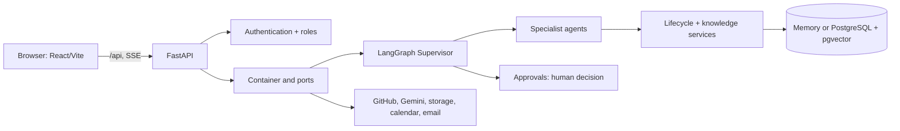

# Welcome Wave: complete project guide

**Verified against this working tree on 17 November 2026.** This is the place to start when learning, running, changing, demonstrating, or operating the project. For exact request fields and the finer business rules, follow the linked source files and specialist documents. The code is the final authority where older documents disagree with it.

**Watch the workflow:** [4:44 narrated animated explainer](video/welcome-wave-workflow-explainer.mp4) ([subtitles](video/welcome-wave-workflow-explainer.srt)). It follows Priya enrolling Maya, Ravi recording a KT session, Maya learning and contributing, and Priya approving the plan and review. The video is generated by [render_explainer.py](../scripts/render_explainer.py).

**Use the current local app:** follow the [first-use walkthrough](LOCAL_FIRST_USE.md) from sign-in through repository setup, enrolment, KT, cited answers and the first pull request.

## 1. What the project does

Welcome Wave is an onboarding workspace for engineering teams. It connects a recorded knowledge-transfer (KT) session to the repository files and functions discussed in the recording. A new engineer can then explore code with a matching video clip, ask questions with cited evidence, follow an onboarding program, and work through a first pull request. Managers can approve plans and reviews, monitor blockers and progress, and see gaps in the team's knowledge.

Its core promise is **“explain code once, reuse the explanation.”** A KT recording is analysed for speech and screen content. Visible file paths and symbols are matched to indexed code, producing links such as “this function was explained in this session at 00:55.” Those links feed the code view, tour, coverage map, KT planner, question answering, and knowledge-risk views.

The project has three audiences:

| Audience | Main job in Welcome Wave |
| --- | --- |
| New hire | Prepare before day one, learn the code, ask, complete tasks and check-ins, request a private review. |
| Expert or mentor | Record KT, answer routed questions, handle access or feedback, support hires. |
| Manager or admin | Set up the workspace, enrol hires, approve agent proposals, book KT, assess progress, and operate the organisation. |
| Executive | Read aggregate reports and organisation-level views; the API blocks organisation-changing requests. |

The **public landing site**, the **signed-in workspace**, and a **token-based pre-boarding portal** share one React application but load as separate chunks. Paths are `/`, `/app#/home` (or `/login`), and `/welcome/<token>` respectively. See [surface.ts](../frontend/src/surface.ts) and [main.tsx](../frontend/src/main.tsx).

### A few terms

| Term | Meaning |
| --- | --- |
| Organisation | The tenant boundary. Business data belongs to one organisation. |
| Project | An organisation's workspace, with members, a repository, documents, KT sessions, and onboarding programs. |
| Program | A hire's plan from enrolment through milestones, check-ins, and completion. A template supplies defaults. |
| KT session | A scheduled knowledge-transfer meeting; its recording can become notes, transcript segments, and code links. |
| Chunk | An indexed piece of code, document, transcript, or answer used for retrieval and citations. |
| KT link | A time range in a session connected to a file or symbol, with a matching method and confidence. |
| Approval | A person’s decision on an agent proposal such as a task plan, PR review, or re-recording. |
| Agent run | A record of a specialist's work; some runs include a filtered step trace. |

## 2. Run it locally

### Prerequisites

- Python **3.11 or 3.12** is recommended for the backend (the repository's `.venv` uses 3.11; CI uses 3.12).
- Node.js and npm for the frontend (CI uses Node 22; this working tree built with Node 20).
- Docker only for `docker compose`, PostgreSQL integration tests, or self-hosted mode. The two-process demo needs no Docker, cloud account, or API key.

From a fresh checkout, use two terminals:

```bash
# Terminal 1, from the repository root
cd backend
python3.11 -m venv .venv   # or python3.12
.venv/bin/pip install -r requirements-dev.txt
MODE=demo .venv/bin/uvicorn app.main:app --host 127.0.0.1 --port 8080
```

```bash
# Terminal 2, from the repository root
cd frontend
npm ci
npm run dev -- --host 127.0.0.1
```

Open **http://127.0.0.1:5173/** for the site, then **http://127.0.0.1:5173/login** for the demo sign-in. Choose a listed demo account, or use `priya@demo.dev` with password `welcome-wave`. The frontend's [Vite proxy](../frontend/vite.config.ts) forwards `/api` and `/webhooks` to the backend on port 8080. API liveness and readiness are at `http://127.0.0.1:8080/health` and `/health/ready`; demo-only Swagger is at `/api/docs`.

The demo uses seeded accounts and a small repository in [backend/sample_repo](../backend/sample_repo). Its data lives in memory and resets when the API restarts. The sign-in header is `X-Demo-User` after `POST /api/demo/login`; **it is only a demo mechanism**, never production authentication. A demo can optionally use a Gemini key passed in the launch command's environment for real model output. Without it, an offline stand-in or rule fallback runs; citations and application flows still work. Demo's main settings deliberately ignore `backend/.env`.

You can instead run `docker compose up --build` from the root. That builds the API and nginx-based web container; the web port is 5173. The optional `db` profile is for PostgreSQL work and is not needed for demo mode. See [docker-compose.yml](../docker-compose.yml).

### Demo accounts and a useful first walkthrough

| Account | Role | What to inspect first |
| --- | --- | --- |
| `admin@demo.dev` (Alex) | Admin | Setup, People, Knowledge risk, Agents. |
| `priya@demo.dev` | Manager | Home, Team, Approvals, KT planner, Reports. |
| `ravi@demo.dev`, `meera@demo.dev` | Experts | Expert inbox, KT sessions, mentoring. |
| `vijay@demo.dev`, `arjun@demo.dev`, `sara@demo.dev`, `tom@demo.dev` | New hires at different program days | Home, My program, Code tour, Ask, Tasks. |
| `elena@demo.dev` | Executive | Reports and read-only views. |

Try this sequence after starting a **fresh** demo backend: sign in as Priya; inspect `Home → Team → Vijay`; review a pending plan in `Approvals`; switch to Vijay via the account switcher; open `Code tour`, `Code and KT`, then `Ask`; finally return to Priya for `Knowledge risk` and `KT planner`. For the full seeded scenario, use [DEMO_SCRIPT.md](DEMO_SCRIPT.md). Some copy and counts in that older script may differ from the current code and date. The public pre-boarding example is `/welcome/demo-welcome-arjun`; issuing a new link for Arjun replaces that fixed demo link until restart.

## 3. How the product works, end to end

### Set up and enrol

An admin creates the organisation at first real sign-in, adds a project and members, connects a GitHub repository, and optionally sets up Google Calendar, Calendly, and email. Managers choose a program template, team, mentor, focus area, and start date when they enrol a hire. Enrolment creates the program and a draft plan; a manager reviews the proposed tasks in **Approvals**. The new hire's program then shows milestones, access items, acknowledgements, environment checks, tasks, and check-ins. The 30/60/90 framing can be scaled by the template's duration. See [enrolment.py](../backend/app/lifecycle/enrolment.py), [templates.py](../backend/app/lifecycle/templates.py), and [ADMIN_GUIDE.md](ADMIN_GUIDE.md).

Before day one, a manager can issue a short-lived pre-boarding link. The link is the portal's permission: no regular sign-in is needed. The portal shows selected dates, people, documents, access status, a first-week preview, and a read-only environment-check script. The token is stored as a hash, expires after 14 days, and is replaced when another is issued. See [preboarding.py](../backend/app/lifecycle/preboarding.py) and [specs/preboarding.md](specs/preboarding.md).

### Ingest code, documents, and KT

1. **Repository:** the Librarian reads files from the connected GitHub repository, splits code into chunks with line and symbol metadata, and indexes them for search. On a push it updates changed paths. Repository access is read-only. See [specialists/librarian/agent.py](../backend/app/agents/specialists/librarian/agent.py), [chunking.py](../backend/app/services/chunking.py), and the repository adapters.
2. **Documents:** permitted members upload a document; text is extracted from PDF, DOCX, or text-like content, chunked, and indexed. The original is stored in local disk or Cloud Storage according to mode. See [specialists/librarian/agent.py](../backend/app/agents/specialists/librarian/agent.py) and [routes.py](../backend/app/api/routes.py).
3. **KT recording:** a session is scheduled and its recording imported from Drive or uploaded where supported. The Note-taker analyses clips for utterances, decisions, action items, terms, and moments on screen. Text is redacted before indexing. See [specialists/note_taker/agent.py](../backend/app/agents/specialists/note_taker/agent.py), [scheduling.py](../backend/app/services/scheduling.py), and [specs/scheduling.md](specs/scheduling.md).
4. **KT-to-code link:** for each screen moment, the linker tries an exact or unique file path, then a symbol, then semantic similarity using nearby speech. Each link records file, optional symbol/lines, time range, method, and confidence; adjacent clips are merged. Low-confidence links do not count toward coverage. See [kt_linker.py](../backend/app/services/kt_linker.py) and [knowledge.py](../backend/app/services/knowledge.py).
5. **Reuse:** Code and KT, Code tour, coverage, risk, and the KT planner read the shared knowledge model. A code change can mark an older explanation stale; the Keeper may propose a re-recording or document edit for approval. See [knowledge.py](../backend/app/services/knowledge.py), [knowledge_risk.py](../backend/app/services/knowledge_risk.py), [kt_planner.py](../backend/app/services/kt_planner.py), and [specialists/keeper/agent.py](../backend/app/agents/specialists/keeper/agent.py).

### Ask a question and route it

The Guide's [RAG crew](../backend/app/rag/crew.py) analyses the question, searches indexed code, documents, KT moments and verified answers through separate retrievers, fuses and reranks the results, and hands evidence to the writer. The rule planner and lexical reranker work offline; when a model can think, a bounded model planner and judge can improve them. In an AI run the Guide can take additional read-only tool steps, then produces an answer with numbered citations. A retrieval gate and citation check decide whether that answer is supported. If evidence is weak, the app may offer a related verified answer or a person: mentor first, then an eligible owner. **A person is contacted only after the asker chooses to ask a person.** Office hours, daily interruption caps, urgency, and digest preferences affect delivery. The expert answers in the inbox; a verified answer can be reused later. See [specialists/guide/agent.py](../backend/app/agents/specialists/guide/agent.py), [routing.py](../backend/app/lifecycle/routing.py), [specs/rag-crew.md](specs/rag-crew.md), and [specs/answer-routing.md](specs/answer-routing.md).

Without a model (no Gemini key on the server) the Guide still answers by quoting its sources, labelled **Quoted from the sources**, under the same gates; **Ask a person** works even when search is down. An “offered” or “not enough information” result is a successful guardrail outcome, not an API failure. A search result can be relevant to a person but still fail the retrieval or citation threshold. Do not treat the offline demo answer as proof of the quality of a live Gemini answer.

### First task, PR, and completion

The Scout ranks real first-task candidates from GitHub issues or the hire's plan, taking focus area, explained code, size, tests, competing work, and single-owner critical areas into account. A manager chooses one, and the hire receives a brief. The hire can request a **private pre-submit review** of a diff or draft PR. GitHub PR events drive the regular Reviewer flow; findings are anchored to changed lines, and a manager decides the review approval. A daily tick advances blocker alerts, nudges, summaries, milestones, and due completion work. Completion remains a manager decision. See [first_task.py](../backend/app/lifecycle/first_task.py), [presubmit.py](../backend/app/lifecycle/presubmit.py), [specialists/reviewer/agent.py](../backend/app/agents/specialists/reviewer/agent.py), [tick.py](../backend/app/agents/supervisor/tick.py), and [completion.py](../backend/app/lifecycle/completion.py).

### Feedback, handovers, and reporting

Readers can flag unclear or outdated code, documents, KT moments, and answers. The Keeper can prepare a fix or re-recording proposal, but Welcome Wave does not write into the customer's repository. A departing person's handover collects ownership gaps, KT coverage, and successor work. Managers and executives see reporting built from program events, milestones, blockers, questions, and cohort data. Small survey groups are suppressed by the reporting floor. See [feedback.py](../backend/app/lifecycle/feedback.py), [handover.py](../backend/app/lifecycle/handover.py), [reporting.py](../backend/app/lifecycle/reporting.py), and [specs/visibility.md](specs/visibility.md).

## 4. Architecture and source map



| Location | Responsibility |
| --- | --- |
| [frontend/src/main.tsx](../frontend/src/main.tsx), [surface.ts](../frontend/src/surface.ts) | Choose the site, workspace, or pre-boarding portal; lazy-load each surface. |
| [frontend/src/App.tsx](../frontend/src/App.tsx), [Workspace.tsx](../frontend/src/Workspace.tsx) | Resolve login and account; select a project, route workspace pages via the URL hash, provide navigation. |
| [frontend/src/session.ts](../frontend/src/session.ts) | `SessionContext` holds config, signed-in member, selected project, demo status, and account callbacks. `useSession()` is the page-level access point and throws outside a project. |
| [frontend/src/api.ts](../frontend/src/api.ts), [live.ts](../frontend/src/live.ts) | Add demo or Firebase credentials, handle 401 refresh and errors, upload/download files, consume live SSE updates. |
| [frontend/src/pages](../frontend/src/pages), [frontend/src/lifecycle](../frontend/src/lifecycle) | Knowledge, tasks, approvals, sessions, settings, programs, people, reports, and role-specific UI. |
| [backend/app/main.py](../backend/app/main.py) | FastAPI app, router registration, startup and shutdown, health, headers, request logging. |
| [backend/app/api](../backend/app/api) | HTTP routes, validation, role/project checks, webhooks, streaming. [API.md](API.md) is the route index. |
| [backend/app/config.py](../backend/app/config.py), [container.py](../backend/app/container.py), [ports.py](../backend/app/ports.py) | Mode-specific configuration, dependency wiring, stable interfaces for agents/services, event deduplication and approval resume. |
| [backend/app/agents](../backend/app/agents) | The multi-agent system: `supervisor/` (the LangGraph graph), `specialists/` (one package per agent), `core/` (model adapters, the agent loop, the roster) and `tools/`. Its [README](../backend/app/agents/README.md) explains the layout. |
| [backend/app/rag](../backend/app/rag) | Question analysis, multi-source retrieval, weighted fusion, lexical and optional model reranking for cited answers. |
| [backend/app/lifecycle](../backend/app/lifecycle) | Onboarding business rules: enrolment, routing, progress, blockers, check-ins, completion, visibility, reporting. |
| [backend/app/services](../backend/app/services) | Reusable indexing, KT linking, knowledge, search, scheduling, coverage, risk and other domain calculations. |
| [backend/app/adapters](../backend/app/adapters) | In-memory and PostgreSQL stores, GitHub, Google Cloud, Calendar, mail, and local storage adapters. |
| [backend/db/migrations](../backend/db/migrations) | Forward-only SQL schema migrations, including row-level security, pgvector, live notifications, lifecycle, agent and sign-up additions. |
| [infra](../infra), [cloudbuild.yaml](../cloudbuild.yaml), [.github/workflows/ci.yml](../.github/workflows/ci.yml) | Terraform, worker deployment, Cloud Build, and CI checks. |

### Follow one question through the code

Suppose Vijay asks, “Where does `check_labels` report missing labels?” in the **Ask** page. This is a useful reading path through the repository:

1. [Chat.tsx](../frontend/src/pages/Chat.tsx) gathers the selected project and question. [api.ts](../frontend/src/api.ts) sends `POST /api/ask/free` for a typed request, or `POST /api/ask/route` when going straight to the Guide or following up on an offer, with the demo header or a Firebase bearer token.
2. [main.py](../backend/app/main.py) applies the request limits, security headers and router. [auth.py](../backend/app/api/auth.py) resolves the member and project access. In a real mode the limited database role and PostgreSQL row-level security also enforce the organisation boundary.
3. [lifecycle.py](../backend/app/api/lifecycle.py) starts the request. [container.py](../backend/app/container.py) supplies mode-specific adapters and runs the appropriate LangGraph path. The [Supervisor](../backend/app/agents/supervisor/graph.py) routes an answer request to the [Guide](../backend/app/agents/specialists/guide/agent.py); a free-form request can instead become another specialist's proposal.
4. [analyze.py](../backend/app/rag/analyze.py) recognises `check_labels` as an identifier and plans searches. [crew.py](../backend/app/rag/crew.py) retrieves candidates from code, documents, KT and verified answers; [fuse.py](../backend/app/rag/fuse.py) combines lists and [rerank.py](../backend/app/rag/rerank.py) orders evidence. The index implementation is [memory.py](../backend/app/adapters/memory.py) in demo or [postgres.py](../backend/app/adapters/postgres.py) in real modes.
5. The Guide may call the read-only tools in [agents/tools](../backend/app/agents/tools). Its writer cites numbered sources. [routing.py](../backend/app/lifecycle/routing.py) applies the retrieval and citation gates. The result is an answer, a verified answer, or an offer to ask a person; it is never a silently sent message.
6. The API returns the answer, sources, trace steps and a compact `crew` summary. The frontend shows the citations and any linked KT clip. To inspect the boundary precisely, start with [PERMISSIONS.md](PERMISSIONS.md), [API.md](API.md), [specs/rag-crew.md](specs/rag-crew.md) and the matching test in `backend/tests/`.

The ingestion path runs in the other direction: [specialists/librarian/agent.py](../backend/app/agents/specialists/librarian/agent.py) reads a connected repository, [chunking.py](../backend/app/services/chunking.py) splits files and records symbols and line spans, and an index adapter stores their text and embeddings. A recording goes through [uploads.py](../backend/app/api/uploads.py) or a Drive import, then [specialists/note_taker/agent.py](../backend/app/agents/specialists/note_taker/agent.py) extracts notes and screen moments; [kt_linker.py](../backend/app/services/kt_linker.py) connects those moments to the indexed code. Those stored chunks and links become the Guide's evidence and the Code and KT page's clips.

### Read the entire codebase by responsibility

| Area | Entry points and purpose |
| --- | --- |
| Browser bootstrap | [main.tsx](../frontend/src/main.tsx) lazy-loads the site, signed-in app or pre-boarding portal; [surface.ts](../frontend/src/surface.ts) chooses by URL. [AppEntry.tsx](../frontend/src/AppEntry.tsx) handles the account entry, [Workspace.tsx](../frontend/src/Workspace.tsx) owns signed-in navigation, and [session.ts](../frontend/src/session.ts) holds the current member and project. |
| Browser transport | [api.ts](../frontend/src/api.ts) applies Firebase or demo credentials and handles JSON, uploads and errors; [live.ts](../frontend/src/live.ts) consumes server-sent events; [route.ts](../frontend/src/route.ts) and [scroll.ts](../frontend/src/scroll.ts) support navigation. |
| Browser features | [pages](../frontend/src/pages) contains Ask, Code, Code tour, meetings, tasks, approvals, review, risk, planning, settings and expert inbox. [lifecycle](../frontend/src/lifecycle) contains enrolment, programs, people, reports, visibility, agent runs and the token-based pre-boarding portal. [site](../frontend/src/site) contains the public marketing site and scroll-driven film. |
| HTTP boundary | [main.py](../backend/app/main.py) starts FastAPI and registers routers. [api/auth.py](../backend/app/api/auth.py) verifies identity and project access; [api/lifecycle.py](../backend/app/api/lifecycle.py) serves onboarding and question routes; [api/routes.py](../backend/app/api/routes.py) serves core projects, repositories, documents, sessions and chat; [api/uploads.py](../backend/app/api/uploads.py) handles recording uploads. Other files in [api](../backend/app/api) own agents, audit, members, integrations, insights, webhooks, live streams and internal jobs. |
| Configuration and contracts | [config.py](../backend/app/config.py) validates `demo`, `self_hosted` and `gcp` settings; [ports.py](../backend/app/ports.py) defines data and service contracts; [container.py](../backend/app/container.py) builds mode-specific dependencies, claims events and resumes approvals. [migrate.py](../backend/app/migrate.py) applies the SQL schema. |
| Agent execution | [supervisor/graph.py](../backend/app/agents/supervisor/graph.py) builds the graph and event routing. [runtime.py](../backend/app/agents/core/runtime.py) runs bounded model/tool loops; [tools](../backend/app/agents/tools) expose read-only project-scoped evidence; [registry.py](../backend/app/agents/core/registry.py) holds the roster, modes and run records. The eight specialists are packages under [specialists](../backend/app/agents/specialists), each with an `agent.py`: `librarian`, `note_taker`, `guide`, `planner`, `scout`, `reviewer`, `coach` and `keeper`. [llm.py](../backend/app/agents/core/llm.py) selects Gemini, offline or no-model behavior. |
| Retrieval and answers | [rag](../backend/app/rag) analyses, searches, fuses and judges evidence. [lifecycle/routing.py](../backend/app/lifecycle/routing.py) applies answer tiers, the retrieval/citation guard and person routing. [specialists/guide/qa.py](../backend/app/agents/specialists/guide/qa.py) supports the QA answer path. |
| Onboarding rules | [lifecycle](../backend/app/lifecycle) contains enrolment, template versions, milestones and progress, access and pre-boarding, first tasks and private reviews, blockers and check-ins, surveys and reports, handovers, visibility and organisation export/deletion. These are business decisions the model cannot override. |
| Knowledge rules | [services](../backend/app/services) contains chunking and embeddings, code ownership, KT-to-code linking, coverage, tours, risk, planning, scheduling, redaction, integration checks and mail orchestration. |
| External systems and storage | [adapters](../backend/app/adapters) implements memory and PostgreSQL stores, GitHub App or URL access, Cloud Storage/Vertex, Google Calendar, Calendly and SMTP. [db/migrations](../backend/db/migrations) is the persistent schema and row-level security policy. |
| Background and deployment | [selfhost.py](../backend/app/selfhost.py) runs local polling and ticks; [workers](../backend/workers) consumes cloud jobs. [selfhost.sh](../scripts/selfhost.sh) is the local release command; [cloudbuild.yaml](../cloudbuild.yaml), [infra/terraform](../infra/terraform) and [.github/workflows/ci.yml](../.github/workflows/ci.yml) define the cloud pipeline and gates. |
| Evidence | [tests](../backend/tests) covers domain, API, security, reliability and database behavior; [eval](../backend/eval) measures retrieval and answers; [sample_repo](../backend/sample_repo) is the seeded demo repository. |

For a change, start at the browser page or HTTP route, follow its call into the service or agent, then follow its port into the mode-specific adapter. For a data field, read the matching `ports.py` model and SQL migration. For a permission, read `api/auth.py`, the route and [PERMISSIONS.md](PERMISSIONS.md). For an agent decision, read its specialist, [AGENTS.md](AGENTS.md), the human approval route and its tests.

### Agents and decisions

The LangGraph **Supervisor** routes an event to a specialist, tracks retries and runs, and pauses for approvals. It can chain a second specialist through the graph; specialists do not call each other directly. The roster is [registry.py](../backend/app/agents/core/registry.py), the event map is [supervisor/graph.py](../backend/app/agents/supervisor/graph.py), and the full execution contract is [AGENTS.md](AGENTS.md).

| Agent | Responsibility | Typical trigger or outcome |
| --- | --- | --- |
| Librarian | Index repository and documents | Repository connected or pushed; document uploaded. |
| Note-taker | Process a KT recording | Notes, transcript, screen moments, action items, code links. |
| Guide | Answer and route questions | Cited answer, verified answer, or person offer. |
| Planner | Draft plans, completion reviews, template changes, KT sessions | Plan and template approvals. |
| Scout | Suggest a safe first task | Ranked shortlist and manager-selected brief. |
| Reviewer | Examine a PR or private draft | Findings and recommendation, with manager approval for a regular PR. |
| Coach | Assess blockers and next steps | Nudge, escalation, weekly summary. |
| Keeper | Keep knowledge current | Re-recording, document-edit, and handover proposals. |

When configured with Gemini, thinking agents can use a bounded **think → read-only tool → observe** loop; output schemas and citation checks constrain the result. With no AI or an agent set to `rules`, deterministic paths run. An agent's model output is a proposal; code enforces role, project, evidence, and decision boundaries. The `Agents` page shows modes and runs. Private pre-submit reviews have a narrower visibility policy than shared runs. Live steps use `/api/live?topics=agent:<run_id>`; ordinary project updates also use SSE and are reloaded through authorised API calls.

### Data and state

Demo mode uses [memory.py](../backend/app/adapters/memory.py) and [lifecycle_memory.py](../backend/app/adapters/lifecycle_memory.py). Real modes use PostgreSQL 16 with pgvector via [postgres.py](../backend/app/adapters/postgres.py) and [lifecycle_pg.py](../backend/app/adapters/lifecycle_pg.py). The main schema groups are:

- **Identity and tenancy:** organisations, users, projects, project members, invitations, GitHub installations.
- **Knowledge:** repositories, documents, chunks and embeddings, meetings, transcript segments, screen moments, notes, KT links, verified answers.
- **Work:** onboardings, tasks, approvals, reviews, chat messages, expert requests, notifications.
- **Lifecycle:** templates and program versions, teams, milestones, access, acknowledgements, environment checks, area progress, blockers, check-ins, surveys, summaries, feedback, handovers, metric events.
- **Operations:** agent runs, processed-event leases, outbox, audit log, calendar connections, scheduling links, agent modes and document-edit proposals.

Migrations `001` through `016` are present. [migrate.py](../backend/app/migrate.py) applies them. The app must connect as the limited `ww_app` role; startup rejects a role that can bypass row-level security. Embeddings support hybrid search with vector and text indexes. The full table definitions and relationships are in the SQL files and [architecture/ER diagrams](diagrams/er.png).

### Events, background work, and deployment modes

| Mode | Data, identity, AI | Background work and external services |
| --- | --- | --- |
| `demo` | Seeded memory; demo password/header; offline model unless an explicit key is supplied. | Demo stand-ins for GitHub PRs and calendar/Drive; inline work. Resets on API restart. |
| `self_hosted` | PostgreSQL in Docker; Firebase Authentication; Gemini API key; uploaded files on local disk. | Worker threads, repository polling, local outbox and live PostgreSQL notifications. [selfhost.sh](../scripts/selfhost.sh) sets it up. |
| `gcp` | Cloud SQL + pgvector; Identity Platform; Vertex AI; Cloud Storage. | Cloud Run API/web, Pub/Sub, GKE workers, Cloud Scheduler, GitHub App webhooks. [DEPLOY.md](DEPLOY.md) is the runbook. |

Events are deduplicated by a key, claimed with a lease and heartbeat, then marked done after success. The outbox keeps events that still need publishing; approvals resume paused graph runs. In real modes, PostgreSQL notifications feed the live stream. See [container.py](../backend/app/container.py), [outbox.py](../backend/app/api/outbox.py), [selfhost.py](../backend/app/selfhost.py), and [workers/worker.py](../backend/workers/worker.py).

## 5. Authentication, permissions, and data protection

- In real modes, the browser sends a Firebase ID token. The API verifies it, resolves the user, checks their role and project membership, and sets the organisation context for PostgreSQL row-level security. A first-time invitee must explicitly accept an invitation. See [auth.py](../backend/app/api/auth.py).
- Admin, manager, expert, new-hire and executive roles control routes and data visibility. A hire's private details are visible to the hire, their mentor, and project managers. A cross-organisation or inaccessible project is generally returned as 404. Consult [PERMISSIONS.md](PERMISSIONS.md) for the route matrix.
- The GitHub adapter has read operations only. Human approval is required before plans, regular reviews, re-recordings, and other proposals affect people. Uploaded and retrieved content is treated as untrusted input to agents. The code performs citation, output and permission checks; transcript text is redacted, but **repository code and documents are indexed as supplied**, and screen frames are not generally redacted.
- API responses include request IDs and security headers. Rate limits cover sign-in, chat, public pre-boarding, webhooks and default requests. Audit entries record sensitive operations; administrators can inspect and export them. LangSmith tracing is off by default because it sends prompts and outputs to an external service.
- Self-hosted or cloud deployment requires correct secrets, HTTPS, backups and retention settings. Read [SECURITY.md](SECURITY.md), [ADMIN_GUIDE.md](ADMIN_GUIDE.md), and [DEPLOY.md](DEPLOY.md) before production use.

## 6. Configuration and integrations

[Settings](../backend/app/config.py) are environment variables named after the fields in uppercase. The mode is `MODE=demo|self_hosted|gcp`; `ENV=prod` enforces production checks. `backend/.env.example` describes general settings, and `backend/selfhost.env.example` documents local real-mode values. Keep real credential files outside version control.

| Integration | Why it is used | Where to configure it |
| --- | --- | --- |
| Gemini / Vertex AI | Answers, recording analysis, agent reasoning, embeddings | `GEMINI_API_KEY` locally, or Google Cloud project/model settings. |
| Firebase / Identity Platform | Real account sign-in and invites | Firebase project ID, public web API key, authorised domain; backend verifies ID tokens. |
| GitHub | Read repository, issues, PRs and check changes | GitHub App in cloud mode; repository URL and optional read-only token self-hosted. |
| Google Calendar / Meet / Drive | Book KT and import recordings | OAuth client and per-organisation connection. |
| Calendly | Individual scheduling links and signed booking webhooks | Person's link and webhook signing key. |
| SMTP | Invitations, pre-boarding links and other configured notices | SMTP host, port, sender and credentials. No SMTP means no email delivery. |
| LangSmith | Optional run tracing | `LANGSMITH_TRACING=true` and its own key/project, only after a data-processing decision. |

The definitive setup and live-check steps are in [INTEGRATIONS.md](INTEGRATIONS.md). `./scripts/selfhost.sh check` tests configured self-hosted integrations; [check_models.py](../backend/scripts/check_models.py) probes chosen model IDs. A missing optional integration should be reflected in `/api/config` or the integrations page, rather than assumed to work.

## 7. API and frontend mechanics

The frontend's [api.ts](../frontend/src/api.ts) centralises `GET`/write calls, file uploads, downloads and error messages. It sends `X-Demo-User` in demo mode or a Firebase bearer token in real modes, refreshing a 401 once. [session.ts](../frontend/src/session.ts) exposes the signed-in member and selected project to pages. [Workspace.tsx](../frontend/src/Workspace.tsx) uses hash routes without a router package, project-local navigation and live update subscriptions. `GET /api/config` runs before sign-in to choose the right mode. The site and app load independently, which keeps the public site from downloading Firebase and workspace code until needed.

The backend's [main.py](../backend/app/main.py) registers routers under `/api`, plus `/webhooks`, `/internal`, and `/health`. Route modules validate inputs and enforce auth; domain behavior lives in agents, lifecycle services and adapters. Demo-only OpenAPI at `/api/openapi.json` is useful for exploring the *current* exact request/response models. [API.md](API.md) groups routes by function; [PERMISSIONS.md](PERMISSIONS.md) lists access by role. API tokens have a database table but no public issue/accept/revoke API, so this is **an internal web-app API**, not a versioned customer API.

Example demo request after starting the backend:

```bash
curl -sS -X POST http://127.0.0.1:8080/api/demo/login \
  -H 'Content-Type: application/json' \
  -d '{"email":"priya@demo.dev","password":"welcome-wave"}'

curl -sS http://127.0.0.1:8080/api/me -H 'X-Demo-User: u-priya'
curl -sS http://127.0.0.1:8080/api/home -H 'X-Demo-User: u-priya'
```

Do not use the demo header as an authentication pattern in another deployment. In the browser, use the frontend on port 5173 so its `/api` proxy is used.

## 8. Tests, evaluation, and operations

```bash
cd backend
.venv/bin/python -m pytest -q
MODE=demo .venv/bin/python -m eval.run_eval

cd ../frontend
npm run build                  # TypeScript project build + Vite production build
```

PostgreSQL integration tests require `TEST_PG_ADMIN_URL` pointing to a **scratch** PostgreSQL 16 server with pgvector. Do not point those tests at a valued database: the modules create and drop test databases and roles. CI runs both memory and PostgreSQL tests, retrieval evaluation, frontend type-check/build, CSP checks, shipping-dependency vulnerability gates (development-tool advisories are report-only), and Docker builds. The retrieval gate in [eval/run_eval.py](../backend/eval/run_eval.py) measures known questions; [eval/rag_eval.py](../backend/eval/rag_eval.py) also has a held-out split and an unseen Starlette corpus. Offline answer rates do not measure Gemini's answer quality; live-model review is separate. There are no frontend unit or browser tests in this repository's CI.

For self-hosted work, `./scripts/selfhost.sh setup` creates local database passwords and applies migrations; add Firebase/Gemini settings to `backend/selfhost.env`. `./scripts/selfhost.sh start` serves the development API and Vite server. `./scripts/selfhost.sh release` builds the production images, migrates and starts the API and nginx web app on this machine; `status` and `check` verify them. `backup` writes a dated archive of the database, files, keys and settings under `backups/`; `stop` stops the release and PostgreSQL while retaining its Docker volume. Keep backups off the server. Cloud deployment and rollback are in [DEPLOY.md](DEPLOY.md).

### What was verified on this machine

On 18 November 2026, the frontend type-check and production build passed. Backend lint passed. The full backend suite passed with **999 passed, 76 skipped** without PostgreSQL; the 13 PostgreSQL test files, run against an isolated pgvector/PostgreSQL 16 test container, passed **143 tests**. The temporary test database was removed. The two warnings came from a deliberately short test signing key and the local Python 3.11 runtime's future support window.

`MODE=demo python -m eval.run_eval` passed every configured retrieval gate. On its demo set the crew's R@5 was **0.94** and the offline end-to-end answered rate was **0.65**, with every unanswerable question refused; on the self-codebase set R@5 was **0.75**. A separate held-out evaluation on an unseen Starlette repository found a relevant source in the top five for **0.94** of answerable cases; the offline Guide answered **0.64**, refused 14 of 15 near-misses, and citation precision was **0.47**. These measure the offline writer and hash embeddings, not Gemini answer quality; see [eval/README.md](../backend/eval/README.md) and [specs/rag-crew.md](specs/rag-crew.md#measured). The demo seed now indexes its verified answer, so retrieval can find it.

A live Gemini run on the demo corpus's held-out split (22 questions, 18 answerable) finished with crew retrieval **R@5 0.94**, hit@1 **0.83**, and end-to-end accepted answers **0.83**. Its one unanswerable case was refused, expected-source citation precision was **0.90**, and the run had no errors. This small seeded corpus is a functional check, not evidence of the same quality on a customer's repository. Several questions still put an irrelevant source first; the unseen Starlette result above is the stronger warning about generalisation. The live run took about 16 minutes and the end-to-end p95 was about 48 seconds, so latency and model quota need monitoring.

The self-hosted **production images** built and started locally at `http://localhost:8000`. `/`, `/health/ready` and `/api/config` returned 200 through nginx; `/api/config` reported `mode=self_hosted`, `env=prod`, AI, URL-based GitHub repositories, recording uploads, Google Calendar and email on. The integration check reached real services: Gemini key, Firebase web key and GitHub token worked; fast and fallback Gemini models and embeddings answered. The configured smart model returned Google 503/504 on earlier checks and 429 quota exhaustion after the live RAG run, so model failover and quota monitoring matter. In the `welcome-wave` Google Cloud project, Calendar and Drive APIs are enabled, a separate local web OAuth client is configured, and `calendar.events` and `drive.readonly` scopes are saved. The **Welcome wave** organisation's admin signed into the local app and completed Google consent. The app showed **Google Calendar connected**, the database stored an encrypted refresh token and both scopes, and read-only probes to Calendar events and Drive files both returned HTTP 200. Google marks those scopes unverified; public use needs verification. SMTP is configured and a live Gmail STARTTLS/login probe passed without sending mail. Calendly webhooks are not configured, and `PUBLIC_URL` remains localhost. This verifies a local release and account consent, not an actual calendar booking, Drive recording import, external access, or a cloud deployment.

### Troubleshooting

| Symptom | First check |
| --- | --- |
| Site loads but API calls fail | Is the backend on port 8080? Check `/health/ready`, then the Vite proxy in `vite.config.ts`. |
| Sign-in fails in demo | Restart the backend for fresh seed; use a listed `@demo.dev` account and `welcome-wave`. |
| Data disappears | Demo mode is in memory. Use `self_hosted` for persistence. |
| AI feature says unavailable | Self-hosted mode needs a valid Gemini key; inspect `/api/config` and `selfhost.sh check`. |
| A recording has no code links | Confirm the repository indexed first, then inspect visible paths/symbols and link confidence. |
| A cited answer is refused | Inspect the returned sources and citation/retrieval checks; add or verify evidence rather than lowering a threshold blindly. |
| PostgreSQL test is skipped | Provide `TEST_PG_ADMIN_URL` to a scratch pgvector server. |
| A production request returns 404 for a visible project | Check project membership and organisation tenancy; feature flags may also make a route 404. |

## 9. Current limits and how to read older documents

Features vary by mode and flags. `FEATURES` defaults to `all` and can disable a named lifecycle feature (for example `all,-surveys`); `GET /api/lifecycle/config` shows current flags. The code has no SAML/SCIM provisioning, Slack/Teams, Jira/Linear or HRIS connector, or public token-based API. Reports suppress small survey groups. The landing media are stock footage, and production performance should be checked on the actual hosting setup.

Some older files describe an earlier baseline or phase and contain stale claims: [CURRENT_STATE.md](CURRENT_STATE.md) is intentionally a baseline; [STATUS.md](STATUS.md) includes later updates beneath older “deferred” and “known gap” sections; the PDF PRD and older demo script mention an earlier landing design or recording stack. For example, SMTP support now exists in [mailer.py](../backend/app/adapters/mailer.py), though an older status row says email was not built. Use this guide and current code for the implementation, then the domain docs for detail. When making changes, update any affected guide and avoid treating an old test count as a current result.

## 10. Where to go next

| If you need… | Read… |
| --- | --- |
| A click-by-click product tour | [USER_GUIDE.md](USER_GUIDE.md) and [DEMO_SCRIPT.md](DEMO_SCRIPT.md). |
| Every API route and role | [API.md](API.md), [PERMISSIONS.md](PERMISSIONS.md), demo `/api/docs`. |
| Agent events, tools, budgets and trace privacy | [AGENTS.md](AGENTS.md). |
| Exact lifecycle decisions | [specs/](specs/lifecycle.md), especially answer routing, first task, blockers, visibility, and completion. |
| Production administration | [ADMIN_GUIDE.md](ADMIN_GUIDE.md), [INTEGRATIONS.md](INTEGRATIONS.md), [DEPLOY.md](DEPLOY.md). |
| Security and data processing | [SECURITY.md](SECURITY.md). |
| Design and work history | [PLAN.md](PLAN.md), [STATUS.md](STATUS.md), [brand/BRAND.md](brand/BRAND.md), [landing/](landing/CINEMATIC_BLUEPRINT.md). |

The most useful starting points for a code change are the API route, its lifecycle or service function, the store/port it calls, the matching frontend page, and the tests in `backend/tests/`. Keep permissions and demo/real-mode differences in view throughout the change.
