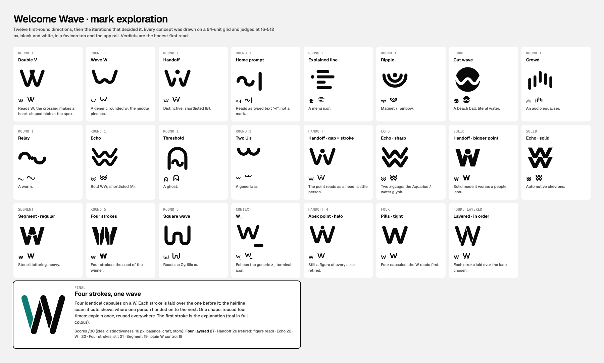
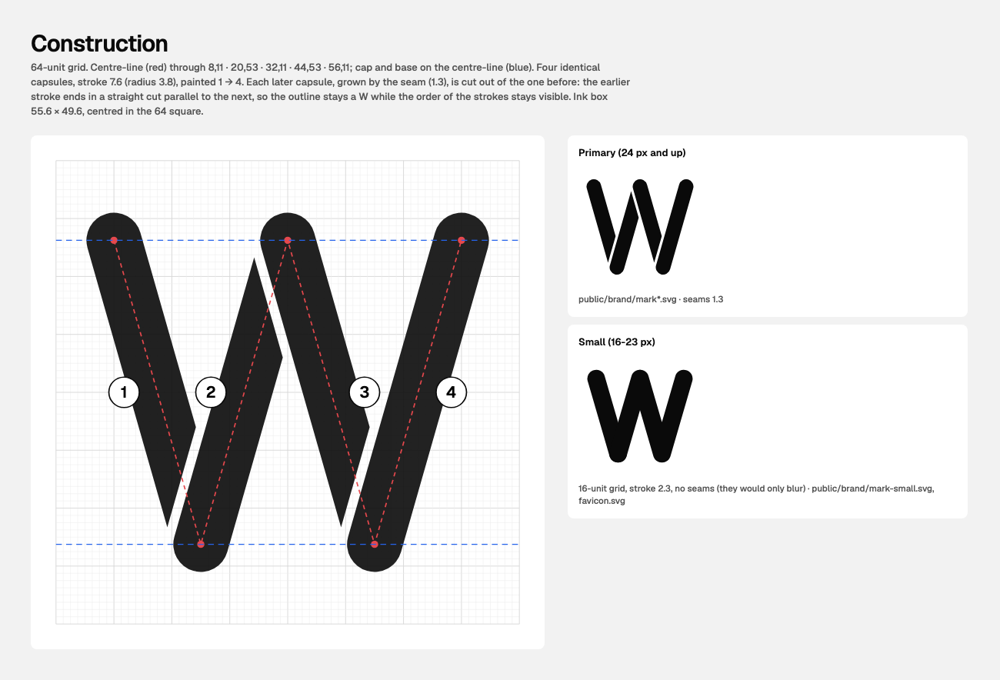
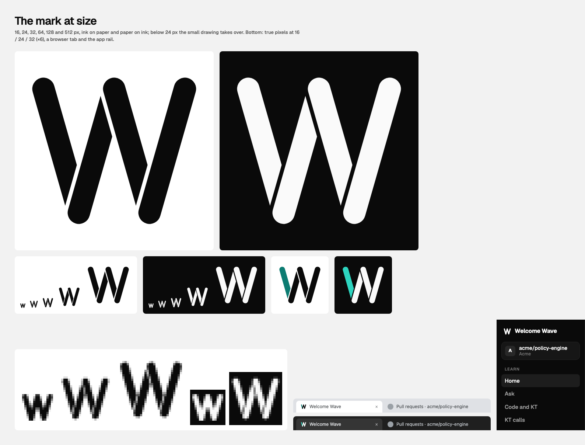
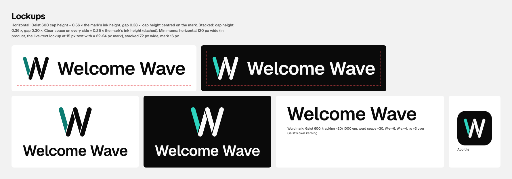

# Welcome Wave brand

**The idea in one sentence:** four identical strokes make the W. Each is laid over the one before it, and the hairline seam it leaves shows where one person handed knowledge on to the next.

One shape reused four times is *explain once, reused everywhere*. Strokes that each pick up exactly where the last one stopped are *a wave travelling through a crowd*. Together they are the W of Welcome Wave.

## 1. Principles

These were written before drawing and used to judge every concept.

1. **One idea, visible in the drawing.** The story must be in the geometry, not added on top as a dot, a swoosh or a tile.
2. **A letter first, a symbol second.** It reads as W at 16 px. The idea rewards a closer look at 64 px and above.
3. **Constructed, not drawn.** It sits on a grid with exact radii and one stroke weight. Every dimension can be written down.
4. **Distinct in silhouette.** It must not be a generic rounded "w", a water glyph, a person, an equaliser, a terminal prompt or a chevron badge.
5. **Monochrome at heart.** It works in pure black and pure white. Teal is allowed only where it means what it means in the product: explained in a KT session.
6. **Warm and precise together.** Round ends for the people, straight cuts for the code.
7. **It has to move.** The construction is also the motion: the strokes arrive in order.
8. **Quiet next to Geist.** The wordmark is the product's own typeface, spaced by hand, with no custom glyph tricks.

## 2. Why this mark

Twelve first-round directions were drawn on a 64-unit grid and judged at 16 to 512 px, in black and white, in a favicon tab and in the app rail. Round one included the classical double V, a wave W, the handoff point, `~|`, an explained-line stack, a ripple, a cut disc, a crowd equaliser, a relay, an echo WW, a doorway and two U's.

Most failed on first read (menu icon, magnet, beach ball, equaliser, ghost). Two were shortlisted and taken through four or more iterations each:

- **Handoff** (two V's passing a point): the best story, and the point is the product's own teal "explained" dot. It was retired because the point reads as a head at every size, which makes it a person and a "people software" icon. That held whether the point was solid, halo-cut, small, square or lifted.
- **Echo** (WW): bold, but two parallel zigzags are the Aquarius and water glyph, which is close to the literal wave this brand avoids.

Four strokes started as a side route: a W made of free-standing strokes, the ASCII `\/\/`. Layering them in order, with the seam cut into the earlier stroke, made the idea visible without changing the W's silhouette. Scores out of 30 (idea, distinctiveness, 16 px, balance, craft, story):

| Direction | Score |
|---|---|
| Four, layered | 27 |
| Handoff | 26 |
| Echo | 22 |
| `W_` | 22 |
| Four strokes, slit | 21 |
| Segment | 19 |
| Plain W (control) | 18 |

## 3. Construction

- **Grid:** 64 units.
- **Centre-line:** passes through 8,11 · 20,53 · 32,11 · 44,53 · 56,11. Cap and base lines are on the centre-line.
- **Strokes:** four identical capsules, stroke 7.6 (radius 3.8), painted 1 to 4 from left to right.
- **Seam 1.3.** Each later capsule, grown by the seam, is cut out of the one before it. The earlier stroke therefore ends in a straight cut parallel to the next stroke, and its tip comes to a sharp point on the outer edge. The outline is still a W, and the order of the strokes stays visible.
- **Ink box:** 55.6 × 49.6, centred in the 64 square, so it sits in UI icon slots without offsets.
- **Small drawing (16 to 23 px):** a 16-unit grid with centre-line 2.3,3.1 to 13.7,12.9 and stroke 2.3. It has no seams, because at that size they only blur.

All paths are exact lines and arcs, with no masks. They come from one generator; the generated paths are in `frontend/src/ui.tsx` (`MARK`, `MARK_SMALL`) and `frontend/public/brand/*.svg`. Change them together.

## 4. Sizes

| Use | Minimum |
|---|---|
| Mark, primary (with seams) | 24 px |
| Mark, small drawing | 16 px (favicon); never below 12 px |
| Horizontal lockup (outlined) | 120 px wide. In the product the lockup is live text: Geist 600 at 15 px beside a 22 to 24 px mark. |
| Stacked lockup | 72 px wide |

## 5. Lockups and clear space

- **Horizontal:** the wordmark's cap height is 0.56 × the mark's ink height. The gap is 0.38 ×, and the cap height is centred on the mark.
- **Stacked:** cap height 0.36 ×, gap 0.30 ×, centred.
- **Clear space:** 0.25 × the mark's ink height on every side of any lockup. That is roughly the width of one stroke pair.

## 6. Colour

| | Light ground | Dark ground |
|---|---|---|
| Ink | `#0a0a0a` | `#fafafa` |
| First stroke, full colour | `#0c7c72` | `#2dd4bf` |
| App tile | — | `#0a0a0a` tile, `#fafafa` mark, `#2dd4bf` first stroke |

**Monochrome is the default.** The product chrome (rail, top bar, sign-in, portal, site nav) uses the mark in the current text colour.

**Full colour** paints only the first stroke teal: the explanation that the other three reuse. Use it on the app icon, the favicon, the lockup files and marketing moments. Never use teal on more than that one stroke, and never use another colour.

## 7. Wordmark

"Welcome Wave" is set in Geist 600 and outlined:

- Tracking −20/1000 em.
- Word space −30.
- Pair adjustments over Geist's own kerning: W·e −6, W·a −4, l·c +3.

No glyph is altered: the mark carries the idea. For live text next to the mark, use Geist 600 to 650 at about −0.015 to −0.02 em.

## 8. Motion

**The intro ("Crowd")** is in `frontend/index.html`, `public/boot-field.js`, `public/boot-words.js` and `src/boot.ts`. It runs about 3.7 s to the hand-off and is gone by 4.4 s.

1. The four strokes draw in order. Each later stroke cuts its seam into the one before as it passes, and the pen's leading edge is the single teal pulse.
2. When the W is complete, one ripple runs out through a field of small strokes (the crowd). They stand up and lean into the mark's angle, so for a moment the crowd is woven of W's.
3. The name rises out of its baseline letter by letter as the wave reaches it.

Interaction:

- **Pointer:** strokes near the pointer stand up and lean toward it, and the lockup drifts up to 8 px after the pointer.
- **Tap or click:** sends a ripple from that point, and also skips the intro.
- **Skipping:** Esc, Enter, Space, Tab, click, tap or scroll.

With reduced motion, the intro is a still lockup that fades in about 1 s.

**Hover** on a brand link in the app: a small stadium wave runs through the four strokes, 55 ms apart.

## 9. Files

`frontend/public/brand/`:

| File | Use |
|---|---|
| `mark.svg` | Full colour, light ground |
| `mark-dark.svg` | Full colour, dark ground |
| `mark-black.svg`, `mark-white.svg` | Mono |
| `mark-small.svg` | 16 px drawing; follows the colour scheme |
| `wordmark.svg`, `wordmark-white.svg` | Outlined wordmark |
| `lockup-horizontal.svg` (+ `-dark`) | Horizontal lockup |
| `lockup-stacked.svg` (+ `-dark`) | Stacked lockup |
| `tile.svg` | Rounded app tile |
| `tile-square.svg` | Full-bleed app tile |
| `mark-512.png` | Rounded tile |
| `icon-512-maskable.png` | Full-bleed tile |
| `apple-touch-icon.png` | 180 px, full bleed |
| `mask-icon.svg` | Mask icon |

`frontend/public/favicon.svg` is the small drawing: ink on light tabs and paper on dark ones, with a teal first stroke.

In React, use `<Logo size={…} />` from `src/ui.tsx`:

- It renders in `currentColor`, so it follows the surface it sits on, whatever `data-theme` says.
- It switches to the small drawing below 24 px.
- `tone="color"` paints the first stroke teal (`--logo-first`, else `--kt`).
- `motion="arrive"` lays the four strokes down once, in order (empty states, page heroes); `motion="busy"` runs a stadium wave through them for as long as it shows (the loading indicator). Both are still under reduced motion.
- `<MarkLine />` draws `MARK_LINE`, the centre-line, as a hairline: the watermark on a recorded call's tile.

## 10. Do and don't

**Do:**

- Let the mark take the text colour of its surface.
- Keep the seams. They are the idea.
- Use the small drawing below 24 px.
- Give the lockup its clear space.
- Animate it in its construction order, left to right.

**Don't:**

- Put the mark in a tile inside the product. The tile is for app icons only.
- Rotate, skew, outline or add a shadow or gradient.
- Colour more than the first stroke, or use any colour other than the teal pair.
- Close the seams at 24 px and up.
- Re-space the wordmark, or set it in another face.
- Reintroduce the old spiral as the logo.

## 11. Motifs in the product

The old spiral and its `SPIRAL` path are gone. Where the product drew it as a motif, it now uses the mark:

- **Empty states** (`fx.tsx` `EmptyState`, the command palette, Code and KT's "not explained yet", the portal's "link no longer works"): the mark in the faint ink, laid down once.
- **Page heroes** (Ask the project, New project): the mark in ink, laid down once. Never in a tile.
- **Loading** (the assistant's "thinking" line): the small drawing with `motion="busy"`.
- **Recorded calls** (the KT clip thumbnails, a call's poster): `MarkLine` in teal, a hairline W running off the tile like a waveform. Teal, because these are KT sessions.
- **Sign-in, without WebGL** (`auth/Entry.tsx` `StrokeField`): the intro's crowd, still, with a large W woven out of its strokes in the panel's corner.
- **Site** (`site/parts.tsx` `Stop`): the headline's full stop is the first stroke, teal on the dark cover, drawn down its slant after the last word lands.
